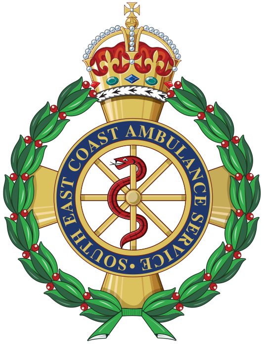

<div align="center">



# Assessment Assistant

**A small web tool that does the boring bits of a 111 call so call handlers don't have to.**

Made for South East Coast Ambulance Service 111 call handlers, by one of them.


</div>

---

## 👋 What's this then?

On a 111 shift you type the same bits of case-note text dozens of times: *"CALL ENDED, CALLER DISCONNECTED"*, LanguageLine interpreter details, lab results read out over the phone, repeat prescription lists, Datix and safeguarding references. It all has to be in the right format, it all has to be in capitals, and it all happens while you're still talking to the patient.

**Assessment Assistant** puts all of that on one screen. You click a button, fill in a box or two, and a correctly formatted note lands on your clipboard ready to paste into the case. It also keeps a scratch notepad, holds every link you need on shift, and reminds you when your breaks are due.

It started as something I built for myself, and it's grown into a proper little toolkit. 🚑

---

## ✨ Features

### 📝 Home: call notepad
- **Autosaving notepad.** Notes survive a refresh or an accidentally closed tab.
- **Plain-text paste.** Pasting from CAD, Pathways or anywhere else won't bring weird formatting in with it.
- **Upper button.** Converts the whole note to CAPITALS in one click.
- **Live word count**, a **Clear** button, and yes, `Ctrl+S` works (muscle memory is real).
- **Quick links bar** for the tools we use all shift: WFM, Service Desk, Datix, Safeguarding, KMS, Respond stats/map, plus the supervisor and LanguageLine numbers in one place.

### 📋 Templates (Call Taker)
One-click, pre-formatted case-note snippets:

| Template | What it does |
|---|---|
| **Call ended (disconnected / silent)** | Drops in the standard wording straight away |
| **Chasing 111** | Asks for the DAS reference, then builds the note |
| **Datix / Safeguarding** | Asks for the reference number, then builds the note |
| **GP practice / Spine match** | Standard "could not confirm" wording |

Plus three small form builders for the fiddly ones:

- 🧪 **Lab Results.** Enter the hospital lab, phone and extension, add result/value pairs to a table, hit Generate, and you get one tidy line. *The Generate button stays disabled until everything required is filled in, so half-finished notes can't happen.*
- 💊 **Repeat Prescriptions.** Build a medication list row by row, then generate the log.
- 🌍 **LanguageLine.** Interpreter ID and language in, standard interpreter note out.

Each one copies with a **"Copied to clipboard"** confirmation, so you never paste the wrong thing into the case.

### 🎓 Templates (Mentoring), coach mode only
For coaches and mentors doing in-line support:

- Quick scripts like *"Listening into your call now"* and *"Opened for in-line support"*
- A **feedback builder** covering **16 call-handling competencies** (setting the scene, active listening, conveying the disposition, risk management and so on). Mark each one as went well or could improve, add the mentee's name and extension, and it writes the training note for you, sorted into *"What went well"* and *"What could be improved"*.

This turns a 10-minute write-up into roughly 30 seconds of clicking, and the feedback comes out consistent from coach to coach.

### 📞 Templates (CSD / OPS)
- Switch duty mode: **Call Taking**, **CSD Duties** or **OPS Duties**. The sidebar status pill shows what you're on.
- CSD mode asks for your 5-digit extension (and validates it), then **every template is automatically prefixed** with `CSD <ext> ->`.
- Callback templates (CB1 / CB2, voicemail left or not, marked for CCN) and "linked to case".
- The tab **stays locked** until you're on a duty that actually needs it, so the wrong templates never end up in front of the wrong person.

### ⏰ My Shift
- **WFM autofill.** Select all and copy your WFM homepage, click once, and it pulls out your shift start/end, breaks and lunch (regex soup, but it works 😅).
- **Lock in** your times, then get **desktop notifications** when each break starts, even if the tab is buried behind CAD. Notifications stay on screen until you dismiss them, because a break reminder that disappears after 3 seconds helps nobody.
- **WFM deep link** with today's date already filled in.

### 🚨 Dispatch Functions
Opens the companion dispatch tool in its own tab. I've deliberately kept it separate so the call handler screen stays uncluttered.

### 🎨 Little touches
- Light / dark theme, remembered between sessions
- Sidebar tabs and controls have ARIA labels/roles
- Copy buttons flash so you *know* the click registered mid-call

---

## 🛠️ How it's built

Deliberately simple:

```
Assessment-Assistant/
├── index.html   # layout + all the tabs/panels (~730 lines)
├── app.js       # everything the buttons actually do (~1,250 lines)
├── styles.css   # theming via CSS variables, light + dark (~1,200 lines)
├── sw.js        # tiny service worker, only used for break notifications
├── crest.png
└── favicon.ico
```

- **Vanilla HTML, CSS and JavaScript.** No frameworks, no npm, no build step. Open it and it runs.
- **No backend and no outbound API calls.** Everything happens in the browser: the DOM, the Clipboard API, `localStorage` for the notepad and theme, and the Notifications API for breaks.
- **Defensive DOM building.** User-entered table rows are built with `createElement`/`textContent` instead of `innerHTML`, so pasted text can't inject markup.
- **Graceful fallbacks.** If `navigator.clipboard` isn't available or permission is refused, it falls back to the classic hidden-textarea copy, and WFM autofill falls back to a paste prompt.

---

## 🚀 Running it

**Quickest:** open `index.html` in Chrome or Edge. Done.

**For break notifications** the service worker needs to be served over `http(s)://` or `localhost`, not `file://`:

```bash
# any static server works, e.g.
python -m http.server 8080
# then open http://localhost:8080
```

It's static files only, so it's equally happy on GitHub Pages, an internal IIS share or an intranet site.

---

## 🔒 Data & privacy notes

Worth being upfront about, since this sits next to patient calls:

- **Nothing is sent anywhere.** There's no server, analytics or tracking. The only external request is the NHS logo image.
- The notepad autosaves to the browser's **`localStorage` on that machine**. It's meant for scratch notes during a call and should be **cleared between calls** (that's what the Clear button is for). The case record itself stays in the proper system.
- No credentials are stored, and the tool never logs into anything. It just links out to the existing SECAmb systems.

---

## 🗺️ Known bits & roadmap

I'd rather list these myself than have someone find them:

- [ ] **WFM deep link uses a hard-coded employee ID** (mine 🙃). That's fine while it's a personal tool, but it's the first thing to change into a user setting before any wider rollout.
- [ ] Optional auto-clear of the notepad (on a timer or when the tab closes) for shared workstations
- [ ] Tidy up a couple of mismatched lab-form IDs and labels, and the mentee-name lookup in the mentoring builder
- [ ] Make the WFM parser more resilient, since WFM changes its layout without warning
- [ ] Move templates into a config file so new wording doesn't need a code change
- [ ] Host the NHS logo locally so the tool makes zero external requests

---

## 🙌 About

Built by **Tavaius Wisbey** (Tay), a 111 call handler and coach at SECAmb, mostly on days off and partly out of spite towards retyping the same sentence 40 times a shift :D

Feedback, ideas and "can it also do…?" requests are very welcome.

<div align="center">
<sub>Designed for the South East Coast Ambulance Service · Internal use only · Not an official SECAmb or NHS product</sub>
</div>
