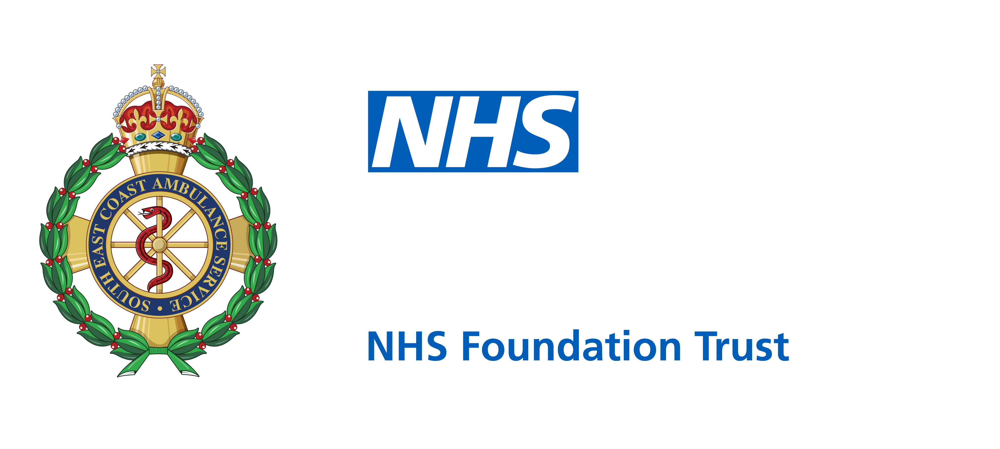

# Assessment Assistant

**A web-based utility that helps Health Advisors take calls quicker and easier.**
 **Includes templates, scripts, shift/break reminders, note-taking tools and more.**

Made for the South East Coast Ambulance Service's 111 Health Advisors.

---

## What is the Assessment Assistant?

Health Advisor call handling shifts often require the same bits of case-note text dozens of times: LanguageLine interpreter details, lab results read out over the phone, repeat prescription lists, Datix and safeguarding references. It all has to be in the right format, it all has to be in capitals, and it often all happens while you're still talking to the patient.

**Assessment Assistant** puts all of that on one screen. You click a button, fill in a box or two, and a correctly formatted note lands on your clipboard ready to paste into the case. It also keeps a scratch notepad, holds every link you need on shift, and reminds you when your breaks are due, helping ensure staff return from breaks at a timely manner, and remember to take them when they are allocated.

It started as something I built for myself, and it's grown into a nifty little toolkit.

---

## Features

### Home: Call notepad
- **Autosaving notepad.** Notes survive a refresh or an accidentally closed tab.
- **Plain-text paste.** Pasting from CAD, Pathways or anywhere else won't bring weird formatting in with it.
- **Upper button.** Converts the whole note to CAPITALS in one click.
- **Live word count** with a **Clear** button for new calls.
- **Quick links bar** for the tools we use all shift: WFM, DAS, Datix, Safeguarding, KMS, Respond stats/map, plus the supervisor and LanguageLine numbers in one place.

### Templates (Call Taker)
One-click, pre-formatted case-note snippets:

| Template | What it does |
|---|---|
| **Call ended (disconnected / silent)** | Drops in the standard wording straight away |
| **Chasing 111** | Asks for the DAS reference, then builds the note |
| **Datix / Safeguarding** | Asks for the reference number, then builds the note |
| **GP practice / Spine match** | Standard "could not confirm" wording |

Plus three small form builders:

- **Lab Results.** Enter the hospital lab, phone and extension, add result/value pairs to a table, hit Generate, and you get one tidy line. *The Generate button stays disabled until everything required is filled in, so incomplete notes can't happen.*
- **Repeat Prescriptions.** Build a repeat prescription order, providing the call taker with an extensive, but not exhaustive, list of commonly prescribed medication within the UK to assist with spelling and overall OHT management.
- **LanguageLine.** Interpreter ID and language in, standard interpreter note out.

Each one copies with a **"Copied to clipboard"** confirmation, so you never paste the wrong thing into the case. These also aim to avoid notes being lost in translation, as different Health Advisors will use different abbreviations, terminology etc. Some will write too many notes, some won't document enough. These standard templates ensure the message that is needed to be documented is clear, concise, and quickly input.

### Templates (Mentoring), coach mode only
For coaches and mentors doing in-line support:

- Quick scripts from CAD shortcuts like *"Listening into your call now"* and *"Opened for in-line support"*
- A **feedback builder** covering 16 call-handling competencies (setting the scene, active listening, conveying the disposition, risk management and so on). Mark each one as went well or could improve, add the mentee's name and extension, and it writes the training note for you, sorted into *"What went well"* and *"What could be improved"*. **Coaches should not be lazy and should remember to personalise their feedback still, and customise it. This should be used as a template/skeleton feedback.**

This turns a 10-minute write-up into roughly 30 seconds of clicking, and the feedback comes out consistent from coach to coach.

### Templates (CSD / OPS)
- Switch duty mode: **Call Taking**, **CSD Duties** or **OPS Duties**. This will change what tools are available to you.
- CSD mode asks for your 5-digit extension, then **every template is automatically prefixed** with `CSD <ext> ->`.
- Callback templates (CB1 / CB2, voicemail left or not, marked for CCN) and "linked to case".

### My Shift
- **WFM autofill.** Select all and copy your WFM homepage, click once, and it pulls out your shift start/end, breaks and lunch (regex spaghetti but has the potential to be automated with WFM team's assistance <3).
- **Lock in** your times, then get desktop notifications when each break starts, even if the tab is hidden behind CAD. Notifications stay on screen until you dismiss them.
- **WFM deep link** with today's date already filled in.

### Dispatch Functions
TBA

## Data & privacy notes

Worth being upfront about, since this sits next to patient calls and I know concerns were raised regarding this already:

- **Nothing is sent anywhere.** There's no server, analytics or tracking. The only external request is the NHS logo image. The WFM shift picker does not read any data from WFM itself, but rather your clipboard. If it recognises it isn't in the usual format, it will spit it out and refuse it, giving the impression it is.
- The notepad autosaves to the browser's localStorage on that machine. It's meant for scratch notes during a call and should be cleared between calls (that's what the Clear button is for). It is therefore not possible for call-handlers to access the same notes they had written from SECAmb desktops.
- No credentials/logins/patient details/sites are stored, and the tool never logs into anything. It just links out to the existing SECAmb systems. Further security can be implemented once further integration with SECAmb is established, and a proper roadmap is made.

## About

Built by Tavaius W. (Tay), a HA, Coach and RD. This was developed mostly on days off and partly out of spite towards retyping the same sentence 40 times a shift, as well as SECAmb's lack of IG regarding note-taking. Channel 4 would have another field day.

Feedback and ideas are very welcome.

Designed for the South East Coast Ambulance Service. Internal use only.

